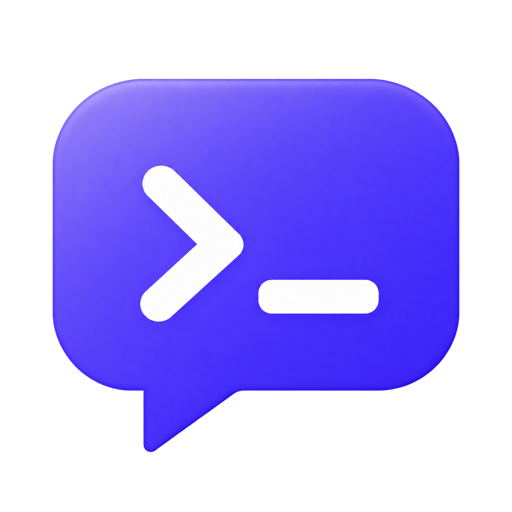
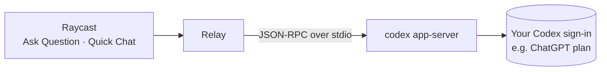

<p align="center">
  
</p>

<h1 align="center">Relay AI</h1>

<p align="center">
  <strong>Quick AI answers and chats in Raycast, powered by the coding agent you already pay for.</strong>
  <br>
  No API keys, no extra subscription. Just ask.
</p>

<p align="center">
  
  
  
</p>

---

Relay sends your question to an AI coding agent installed on your Mac, such as the [Codex CLI](https://github.com/openai/codex), and streams the answer into Raycast. The agent signs in with your existing plan (for example ChatGPT through Codex), so there's nothing new to pay for and no API key to manage.

- **Ask without the ceremony.** Type a question, get one answer. No new chat to create, no app to open.
- **Chat when you need to.** Turn any answer into a conversation, or start one in Quick Chat.
- **See what the agent does.** Web searches, pages it reads and its reasoning show up live, and every source is one click away.
- **Your model, your call.** Pick the model, how hard it thinks and whether it runs in fast mode.

## Commands

| Command          | What it does                                                                                                                                          |
| ---------------- | ----------------------------------------------------------------------------------------------------------------------------------------------------- |
| **Ask Question** | One question, one answer. Press <kbd>↵</kbd> on the answer to **Continue in Chat** when you have a follow-up.                                         |
| **Quick Chat**   | A classic chat: the search bar is the message box, every exchange is a list item and the answer sits next to it. Earlier chats are one dropdown away. |

Both take an optional argument, so `Ask Question ⇥ your question` or `Quick Chat ⇥ your message` works straight from the root search.

### Ask from anywhere: use Relay as a fallback command

Set **Ask Question** as a fallback command (Raycast Settings → Extensions → Ask Question → _Fallback Command_). Then type any question into Raycast's root search and pick **Ask Question** at the bottom of the results.

### See what the agent is doing

While the agent works, one status line shows what it's doing right now: searching the web (with the query), reading a page, or reasoning, titled by the model's own summary (e.g. _Comparing sources_). When the answer arrives, the line becomes a summary such as _Searched the web 2 times · Thought for 4s_.

Next to the answer, a sidebar (<kbd>⌘ I</kbd>) lists the model that answered, every page behind the answer, and the duration and token count. When your plan's usage limit gets close, it shows how much is left.

### Model controls

From the action panel (<kbd>⌘ K</kbd>), also before you ask:

| Control                        | What it does                                                                         |
| ------------------------------ | ------------------------------------------------------------------------------------ |
| **Model** <kbd>⌘ ⇧ M</kbd>     | Any model your Codex account offers.                                                 |
| **Reasoning** <kbd>⌘ ⇧ R</kbd> | The reasoning efforts the model supports, from Low to Ultra. Lower answers faster.   |
| **Fast Mode** <kbd>⌘ ⇧ F</kbd> | The model's faster service tier, when it has one. It uses more of your plan's quota. |

Your choice is remembered and applies to both commands.

## Getting started

1. Install the [Codex CLI](https://github.com/openai/codex): `npm install -g @openai/codex` or `brew install codex`.
2. Sign in once in your terminal: `codex login`.
3. Install Relay. Until it's in the Raycast Store, install it from source:

   ```bash
   git clone https://github.com/Hinkolas/raycast-relay.git
   cd raycast-relay
   npm install
   npm run dev
   ```

   `npm run dev` adds Relay to Raycast. It stays installed after you stop the command.

4. Open Raycast and run **Ask Question** or **Quick Chat**.

Relay finds `codex` through your login shell's `PATH` and the usual install locations (Homebrew, npm, nvm, `~/.local/bin`). If yours lives elsewhere, set **Codex CLI Path** in the extension preferences.

## Shortcuts

| Action            | Shortcut         |
| ----------------- | ---------------- |
| Send / Continue   | <kbd>↵</kbd>     |
| Copy Answer       | <kbd>⌘ ⇧ C</kbd> |
| Paste Answer      | <kbd>⌘ ⇧ V</kbd> |
| Stop Answering    | <kbd>⌃ C</kbd>   |
| Regenerate Answer | <kbd>⌘ R</kbd>   |
| New Chat          | <kbd>⌘ N</kbd>   |
| Change Model      | <kbd>⌘ ⇧ M</kbd> |
| Reasoning Effort  | <kbd>⌘ ⇧ R</kbd> |
| Toggle Fast Mode  | <kbd>⌘ ⇧ F</kbd> |
| Show/Hide Details | <kbd>⌘ I</kbd>   |
| Delete Chat       | <kbd>⌃ D</kbd>   |

## Preferences

| Preference              | Description                                                          |
| ----------------------- | -------------------------------------------------------------------- |
| **Web Search**          | Let the agent search the web for current information. On by default. |
| **Custom Instructions** | Added to every conversation, e.g. "Answer in German".                |
| **Codex CLI Path**      | Only needed when `codex` isn't found automatically.                  |

## How it works



Relay starts `codex app-server`, the same interface the Codex IDE extension uses, and streams answers from it. Every chat runs:

- with a chat-assistant system prompt instead of Codex's coding-agent prompt,
- in a read-only sandbox with approvals turned off, inside an empty folder in the extension's support directory,
- on **ephemeral threads**, so your questions don't clutter your Codex session history.

Chat history stays on your Mac in Raycast's local storage. When you reopen an earlier chat, its transcript is handed to a fresh thread.

## Roadmap

- [x] Codex CLI
- [ ] Claude Code
- [ ] OpenCode

## Development

```bash
npm install
npm run dev     # run Relay in Raycast with hot reload
npm run lint
npm run build
```

Providers live in `src/providers/` and don't depend on Raycast APIs. A new provider implements the `Provider` interface in `src/providers/types.ts` and is registered in `src/lib/settings.ts`.

---

Released under the [MIT License](LICENSE).

<sub>Relay AI is an independent project and isn't affiliated with Raycast, OpenAI or Anthropic.</sub>
