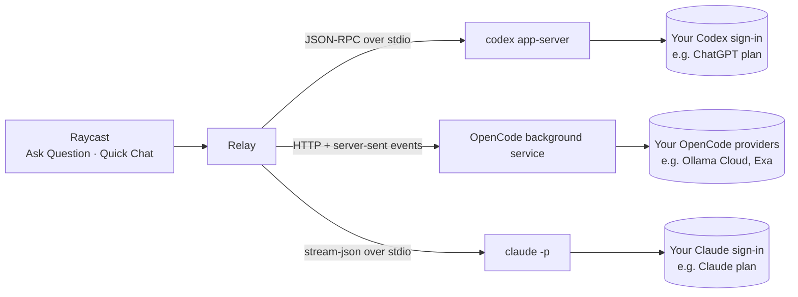

<p align="center">
  
</p>

<h1 align="center">Relay AI</h1>

<p align="center">
  <strong>Quick AI answers and chats in Raycast, powered by the coding agent you already pay for.</strong>
  <br>
  No API keys, no extra subscription. Just ask.
</p>

<p align="center">
  
  
  
</p>

---

Relay sends your question to an AI coding agent installed on your Mac, the [Codex CLI](https://github.com/openai/codex), [OpenCode](https://opencode.ai) or [Claude Code](https://claude.com/claude-code), and streams the answer into Raycast. The agent uses the setup you already have: your ChatGPT plan through Codex, your Claude plan through Claude Code, or whatever providers, models and web search you connected in OpenCode. There's nothing new to pay for and no API key to manage.

- **Ask without the ceremony.** Type a question, get one answer. No new chat to create, no app to open.
- **Chat when you need to.** Turn any answer into a conversation, or start one in Quick Chat.
- **See what the agent does.** Web searches, pages it reads and its reasoning show up live, and every source is one click away.
- **Your model, your call.** Pick the agent, the model, how hard it thinks and whether it runs in fast mode.

## Commands

| Command          | What it does                                                                                                                                          |
| ---------------- | ----------------------------------------------------------------------------------------------------------------------------------------------------- |
| **Ask Question** | One question, one answer. Press <kbd>↵</kbd> on the answer to **Continue in Chat** when you have a follow-up.                                         |
| **Quick Chat**   | A classic chat: the search bar is the message box, every exchange is a list item and the answer sits next to it. Earlier chats are one dropdown away. |

Both take an optional argument, so `Ask Question ⇥ your question` or `Quick Chat ⇥ your message` works straight from the root search.

### Ask from anywhere: use Relay as a fallback command

Set **Ask Question** as a fallback command (Raycast Settings → Extensions → Ask Question → _Fallback Command_). Then type any question into Raycast's root search and pick **Ask Question** at the bottom of the results.

### See what the agent is doing

While the agent works, one status line shows what it's doing right now: searching the web (with the query), reading a page, or reasoning, described by the model's own summary (e.g. _Comparing sources_). When the answer arrives, the line becomes a summary such as _Searched the web 2 times · Thought for 4s_.

Next to the answer, a sidebar (<kbd>⌘ I</kbd>) lists the model that answered, every page behind the answer, and the duration and token count. When your plan's usage limit gets close, it shows how much is left.

### Model controls

From the action panel (<kbd>⌘ K</kbd>), also before you ask:

| Control                        | What it does                                                                                                        |
| ------------------------------ | ------------------------------------------------------------------------------------------------------------------- |
| **Provider** <kbd>⌘ ⇧ A</kbd>  | Codex, OpenCode or Claude Code.                                                                                     |
| **Model** <kbd>⌘ ⇧ M</kbd>     | Any model your Codex or Claude account offers, or every model of the providers you connected in OpenCode.           |
| **Reasoning** <kbd>⌘ ⇧ R</kbd> | The reasoning efforts (OpenCode: variants) the model supports, from Low to Max. Lower is faster.                    |
| **Fast Mode** <kbd>⌘ ⇧ F</kbd> | The model's faster mode, when it has one (Codex, Claude Code). It uses more of your quota or is billed extra usage. |

Your choice is remembered and applies to both commands. Each provider remembers its own model.

## Getting started

1. Set up at least one agent:
   - **Codex CLI:** install it with `npm install -g @openai/codex` or `brew install codex`, then sign in once with `codex login`.
   - **OpenCode:** install it from [opencode.ai](https://opencode.ai) and connect a model provider, e.g. with `opencode auth login`. Relay uses OpenCode's background service and your configuration as is, including web search integrations such as Exa.
   - **Claude Code:** install it from [claude.com/claude-code](https://claude.com/claude-code) and sign in once by running `claude`. A Claude subscription, an API key, Amazon Bedrock and Google Vertex all work.
2. Install Relay. Until it's in the Raycast Store, install it from source:

   ```bash
   git clone https://github.com/Hinkolas/raycast-relay.git
   cd raycast-relay
   npm install
   npm run dev
   ```

   `npm run dev` adds Relay to Raycast. It stays installed after you stop the command.

3. Open Raycast and run **Ask Question** or **Quick Chat**. Codex answers by default; pick OpenCode or Claude Code with <kbd>⌘ ⇧ A</kbd> or in the extension preferences.

Relay finds `codex`, `opencode` and `claude` through your login shell's `PATH` and the usual install locations (Homebrew, npm, nvm, `~/.local/bin`, `~/.opencode/bin`). If yours live elsewhere, set their paths in the extension preferences.

## Shortcuts

| Action            | Shortcut         |
| ----------------- | ---------------- |
| Send / Continue   | <kbd>↵</kbd>     |
| Copy Answer       | <kbd>⌘ ⇧ C</kbd> |
| Paste Answer      | <kbd>⌘ ⇧ V</kbd> |
| Stop Answering    | <kbd>⌃ C</kbd>   |
| Regenerate Answer | <kbd>⌘ R</kbd>   |
| New Chat          | <kbd>⌘ N</kbd>   |
| Switch Provider   | <kbd>⌘ ⇧ A</kbd> |
| Change Model      | <kbd>⌘ ⇧ M</kbd> |
| Reasoning Effort  | <kbd>⌘ ⇧ R</kbd> |
| Toggle Fast Mode  | <kbd>⌘ ⇧ F</kbd> |
| Show/Hide Details | <kbd>⌘ I</kbd>   |
| Delete Chat       | <kbd>⌃ D</kbd>   |

## Preferences

| Preference              | Description                                                           |
| ----------------------- | --------------------------------------------------------------------- |
| **Provider**            | The agent that answers: Codex CLI (default), OpenCode or Claude Code. |
| **Web Search**          | Let the agent search the web for current information. On by default.  |
| **Custom Instructions** | Added to every conversation, e.g. "Answer in German".                 |
| **Codex CLI Path**      | Only needed when `codex` isn't found automatically.                   |
| **OpenCode Path**       | Only needed when `opencode` isn't found automatically.                |
| **Claude Code Path**    | Only needed when `claude` isn't found automatically.                  |

## How it works



**Codex:** Relay starts `codex app-server`, the same interface the Codex IDE extension uses, and streams answers from it. Every chat runs:

- with a chat-assistant system prompt instead of Codex's coding-agent prompt,
- in a read-only sandbox with approvals turned off, inside an empty folder in the extension's support directory,
- on **ephemeral threads**, so your questions don't clutter your Codex session history.

**OpenCode:** Relay connects to OpenCode's background service (`opencode service start`), the server its terminal and desktop apps share, so your providers, models, credentials and web search setup work unchanged. Every chat:

- gets Relay's chat-assistant instructions on top of OpenCode's own,
- may only search the web and read pages; every other tool (shell, files, MCP servers) is turned off for the session,
- runs in a session inside Relay's own folder that's deleted again when it's replaced or has been idle for 15 minutes.

The first time the agent searches the web, OpenCode asks whether to allow it. With **Web Search** turned on in Relay, Relay answers that question with _allow_ for you.

**Claude Code:** Relay runs `claude -p` in stream-json mode, the protocol the Claude Agent SDK uses, with one process per open chat. Your sign-in, models and user settings apply. Every chat:

- uses a chat-assistant system prompt instead of Claude Code's coding-agent prompt,
- may only use the `WebSearch` and `WebFetch` tools; MCP servers, hooks and project settings stay out,
- isn't saved to disk (`--no-session-persistence`), so it doesn't show up in `claude --resume`.

Chat history stays on your Mac in Raycast's local storage. When you reopen an earlier chat, its transcript is handed to a fresh thread, session or process.

## Development

```bash
npm install
npm run dev     # run Relay in Raycast with hot reload
npm run lint
npm run build
```

Providers live in `src/providers/` and don't depend on Raycast APIs. A new provider implements the `Provider` interface in `src/providers/types.ts` and is registered in `src/lib/settings.ts`.

---

Released under the [MIT License](LICENSE).

<sub>Relay AI is an independent project and isn't affiliated with Raycast, OpenAI, OpenCode or Anthropic.</sub>
